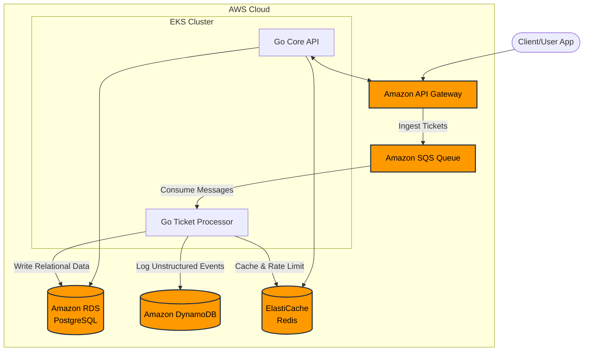

# Experience-Hub Ticketing Backend

A scalable omni-channel support ticketing backend designed to process user requests, categorize tickets, and manage live agent routing. This project demonstrates event-driven architecture, concurrent processing, and a multi-database storage strategy on AWS.

## Architecture Diagram



## Tech Stack

* **Language:** Go (Golang)
* **Infrastructure as Code:** Terraform
* **Compute:** Amazon EKS (Kubernetes)
* **Messaging:** Amazon SQS, Amazon API Gateway
* **Databases:**
  * **Amazon RDS (PostgreSQL):** Stores structured relational state (user profiles, agent assignments, ticket lifecycle).
  * **Amazon DynamoDB:** Logs high-velocity, unstructured activity (chat transcripts, system audit trails) keyed by `TicketID`.
  * **Amazon ElastiCache (Redis):** Handles API rate limiting and caches agent availability status.

## Project Structure

```text
experience-hub/
├── .github/
│   ├── ISSUE_TEMPLATE/
│   │   └── feature_request.md
│   ├── PULL_REQUEST_TEMPLATE.md
│   └── workflows/
│       └── ci.yml
├── cmd/
│   ├── api/
│   │   └── main.go              # Go Core API entrypoint
│   └── worker/
│       └── main.go              # Go Ticket Processor (SQS worker) entrypoint
├── internal/
│   ├── config/
│   │   └── config.go            # Environment configuration loader
│   ├── handlers/
│   │   └── ticket_handler.go    # HTTP handlers for ticket ingestion & queries
│   ├── models/
│   │   └── models.go            # Domain models (Ticket, User, Agent, AuditLog)
│   ├── repository/
│   │   ├── dynamodb.go          # DynamoDB repository (audit logs & transcripts)
│   │   ├── postgres.go          # PostgreSQL repository (relational ticket state)
│   │   └── redis.go             # Redis repository (rate limiting & agent cache)
│   └── worker/
│       └── processor.go         # Concurrent Goroutine SQS consumer pool
├── k8s/
│   ├── deployment.yaml          # Kubernetes Deployments (API & Worker)
│   └── service.yaml             # Kubernetes Service for Core API
├── terraform/
│   ├── main.tf                  # RDS, DynamoDB, ElastiCache Redis, and SQS resources
│   ├── outputs.tf               # Infrastructure outputs
│   ├── providers.tf             # Terraform & AWS provider config
│   └── variables.tf             # Input variables
├── .env.example                 # Example environment variables
├── .gitignore
├── Dockerfile                   # Multi-stage Dockerfile for API and Worker
├── Makefile                     # Common development commands
├── docker-compose.yml           # Local dev stack (Postgres, Redis, LocalStack)
└── go.mod                       # Go module definition
```

## Implementation Phases

### Phase 1: Local Setup & Go API
1. Initialize the Go module and set up the project structure.
2. Build the basic HTTP server using `net/http` (or `Gin` / `Fiber`).
3. Create the data models (`Ticket`, `User`, `Agent`, `AuditLog`).

### Phase 2: AWS Infrastructure (Terraform)
1. Provision an RDS PostgreSQL instance, a DynamoDB table with a Partition Key of `TicketID`, and an ElastiCache Redis cluster.
2. Provision an SQS Queue (with DLQ) for message decoupling.

### Phase 3: Application Logic (Go)
1. Implement a worker in Go utilizing Goroutines to poll the SQS queue concurrently.
2. Write the database repository layer to interact with PostgreSQL (`pgx` / `GORM`), DynamoDB (AWS SDK for Go v2), and Redis (`go-redis`).
3. Wire the ingestion API to push raw payloads directly to SQS for asynchronous processing.

### Phase 4: Containerization & Deployment
1. Build container images using the multi-stage `Dockerfile`.
2. Deploy Kubernetes manifests (`Deployment`, `Service`) to Amazon EKS.

## Quick Start

### 1. Local Dependencies
Start local PostgreSQL, Redis, and LocalStack (SQS & DynamoDB):
```bash
cp .env.example .env
docker compose up -d
```

### 2. Run Core API & Worker
```bash
# Run the Core HTTP API
go run ./cmd/api

# Run the SQS Ticket Processor Worker
go run ./cmd/worker
```

### 3. Provision AWS Infrastructure (Terraform)
```bash
cd terraform
terraform init
terraform plan
```
